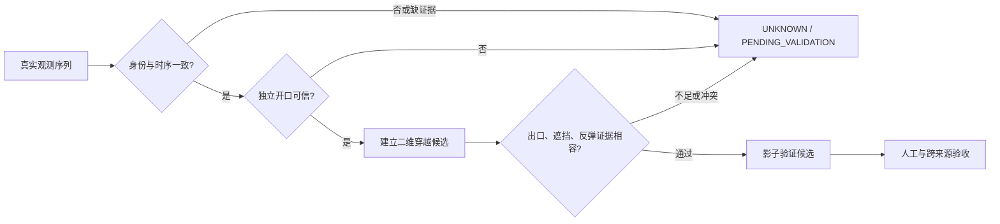

# 穿筐证据改进设计与下一轮预声明

状态：PENDING_VALIDATION。2026-10-20。本轮只建审核工具、运行原版开发集回归，没有实现新命中规则。

## 已知事实与不可推断的内容

现有球检测框不是“真实篮球”的人工证据，篮筐矩形也不是独立的篮圈开口。ScoreEngine用三点中位数球心与跟踪矩形中心线构成二维crossing；只凭该字段无法判别球从筐前、筐后还是开口内经过。

上一轮同感知A/B确认：game01约15秒命中被早期entered窗口挡住；改为穿越后窗口能恢复。但game03约56秒未中也被升为MADE，原有3条命中FP保留。因此窗口改动不能直接启用。

|候选原因|本轮能查的依据|尚缺什么|
|---|---|---|
|选错球|实测/预测标记、全部候选、连续原画|人工真球框及选中物体身份|
|开口定位错误|检测大框与跟踪框叠加|独立开口轮廓/椭圆人工参考|
|前后深度歧义|二维轨迹与原画|可见遮挡顺序/穿网后球位置；不能靠单应矩阵恢复空中球深度|
|错误连接|相邻实测间隔、切镜、跟踪段、平滑前后坐标|断点两侧是不是同一个球|
|遮挡|缺测区间、预测帧|遮挡主体与真实可见区间|
|入口/穿越/出口不一致|逐帧状态、入口期限、实测出口几何|独立物理出口证据；现有引擎无独立exit_t|

这些原因可并存，不互斥。审核完成前不汇报“主要原因占比”，不把缺测一律说成画面看不见球。

## 通用证据结构（设计，不接正式计分）

每个候选记录三层，禁止用一个`measured_crossing`名称覆盖全部：

1. `observation_support`：真实检测与预测分开；帧/时间、球候选身份、尺度、相邻间隔、切镜及筐跟踪段。预测只用于展示和搜索，不给MADE作证。
2. `aperture_geometry`：独立篮圈开口，包含来源、轮廓/椭圆、不确定范围、有效镜头段。检测器的大框不得默认为准确开口。缺少开口就PENDING_VALIDATION。
3. `outcome_support`：进入开口前的真实下降轨迹、过平面的候选区间、后续真实出口；另列回弹、横向逃逸、遮挡冲突和时序不一致。遮挡不能以自动插值“补出”确认命中。

该图是设计，不表示本轮已能输出新的确认命中。对明确擦筐后滚入的球，反弹不是全局MISSED条件；证据不足仍UNKNOWN。球的投影大小、开口角度和镜头透视不同，不能直接用一个固定球/筐宽比证明三维接触。

## 下一轮唯一实验：独立开口对二维穿越的解释力

实验编号：aperture_evidence_shadow_v1。**当前尚未运行。** 前提是五条审核任务完成；两个近似事件可能无法确认时保持UNKNOWN，不排除困难负例。

目的：先验证“检测大框中心线是否是合适的篮圈开口代理”。不同时改窗口、球选择、跟踪器、回弹规则、阈值或出口要求。

### 变量与对照

- A：现有检测/跟踪矩形中心线的二维crossing证据。
- B：固定同一份球观测、同一时序与跟踪段，只替换为独立开口几何，计算`aperture_consistency`影子字段。**不更改任何事件result/points，不自动变MADE，也不把不通过变MISSED。**
- 若开口来自人工框，此轮必须称为**人工几何辅助的上限诊断**；人工结果标签不参与计算。它不能证明自动模型已改善，也不能成为产品推理依赖。模型独立估计的开口需要另一次预声明实验。
- 如无法从人工矩形可靠估计开口平面，只存矩形而不伪造椭圆。扩展标注轮廓/两端点后再运行几何实验。

### 固定输入与防泄漏

锁定源码、权重、输入视频、raw trace、审核表、几何提供器版本的SHA；按真实比赛source_match_id分组，不按剪辑名分组。身份未确认的来源标pending，禁止给它独立测试身份。

基准31条单独报告；三段Bili59次出现/57个play_id单独报告。game03是已暴露验证来源；Bili是Development。所有已公开问题都不是独立测试。

匹配继续±1.5秒一对一，不因离手偏晚扩大窗口。人工几何和结果标签分文件；影子计算只读几何，评价阶段才读结果。配置里不得出现比赛名、事件时刻或期望结果。

### 预声明输出

- 原版事件的出手和命中TP/FP/FN、UNKNOWN，必须逐字段完全不变（纯影子阶段）。
- 每条原MADE与窗口实验MADE的几何支持/反对/不可判，分人工命中、未中、UNKNOWN展示。
- 已知3个命中FP、game03约56秒实验FP、game01约15秒真命中分别逐条列出；170秒先做身份审核，未确认不强配对。
- 几何来源覆盖率、不可判率、人工几何与自动几何分列；遮挡、篮板、弹框、侧向经过等细分只用人工确认标签。
- 不报告新的生产MADE数量或生产精度提升。这个实验只检验一种证据能否区分错误。

### 停止条件与后续启用门槛

若开口几何也不能区分真命中与假穿越，拒绝把它作为独立MADE充分条件。若真球选错是主因，下一轮另立球身份实验，不能顺手联合调参。

任何后续改判实验必须独立预声明，报告新FP、丢失TP、FN、UNKNOWN和每个来源；新增FP或真命中受损需解释并保持默认不变。未锁定未见过的比赛来源前，不进行正式跨比赛泛化验收。

## 人工需补的具体内容

1. 五条审核页：先看无模型框连续原画，再框真实球/篮圈开口；记录是否穿网、反弹、掠过、遮挡，允许UNKNOWN。
2. game01约170秒：人工出手与171.67秒模型事件是否同一次；不要为迎合±1.5秒而改时间。
3. 三段Bili：整场比赛日期、对阵或原片来源；集锦各段的原片时间映射（可未知）。不要求为了得到指标编造统一偏移。
4. 11条未匹配事件：先确认是否真实出手，再分类传球/运球/争球/其他/看不清。当前这些分类没有完整人工标注。
5. 若要正式去回放评测，补两次回放的起止区间和同一play_id关系；不能按猜测区间抹掉FP。

视频文件已齐。当前阻碍是证据标注与独立来源身份，不是缺少现有三段文件。
