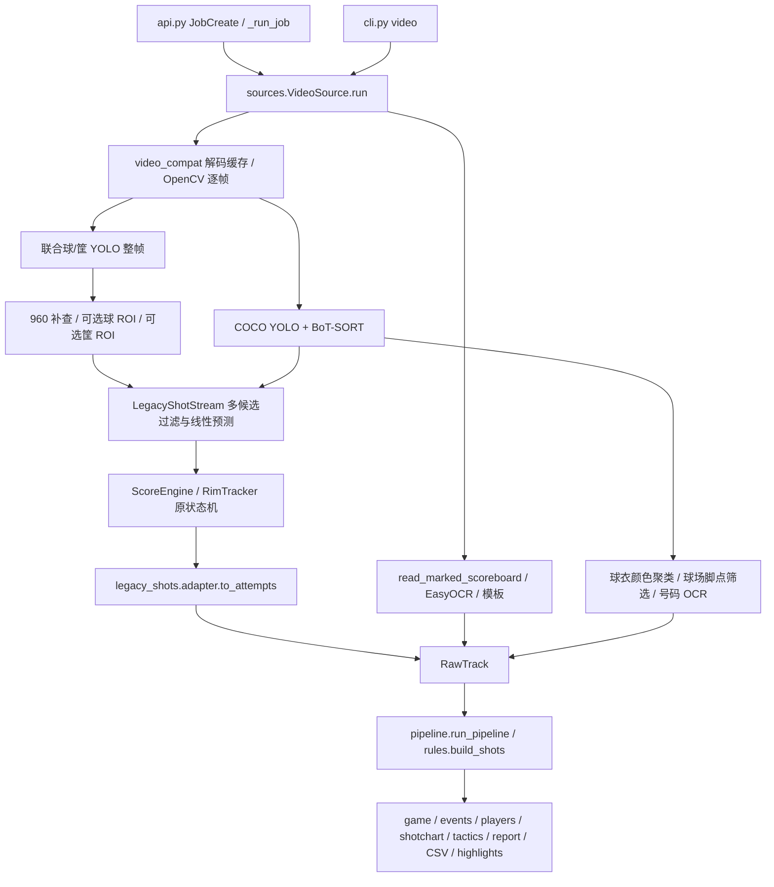

# 篮球视频分析：步骤 1、2 诊断与基线

日期：2026-10-15。项目：`/data/projects/ai-basketball-analyst`。

## 1. 本轮边界与复现身份

完成仓库诊断、现有标注核对、真实 GPU 推理与评估工具核验。没有修改检测/追踪/状态机的业务代码，没有训练、替换权重、重建线上任务或重启服务。

基线不是干净的 Git 提交：HEAD 为 `56b9317d8cc561199786811069d54c40d2e47da5`，工作区已有大量改动，包含上一项暂停的记分牌功能。不能将本报告称为该提交原始版本或线上已加载进程的准确率。本轮开始测量时已保存工作区源码快照、差异、源文件 SHA-256；算法比较必须使用此快照，而不是只写 HEAD。

本机证据目录：[`out/cv_baseline_20261015`](../../out/cv_baseline_20261015)。视频、审核图片、权重、任务数据库和基线产物继续留在本机，不加入 Git。

## 2. 已核实的实际配置

| 项目 | 本机实际情况 |
| --- | --- |
| Python / PyTorch | 3.11.15 / 2.11.0+cu128，CUDA 可用，CUDA runtime 12.8 |
| GPU | Quadro RTX 5000，16 GiB；NVIDIA 驱动 595.84 |
| Ultralytics / OpenCV | 8.4.175 / 5.0.0 |
| 球员模型 | `.env` 指向 `models/yolov8n.pt`，COCO 80 类；后处理接收 `person`，**推理调用没有限制 `classes=[0]`** |
| 球/筐默认模型 | `models/BODD_yolov8n_0001.pt`，E-BARD **YOLOv8n 四类**：0 basketball、1 hoop、2 player、3 referee；不是两类 YOLOv8s |
| 模型训练信息 | E-BARD checkpoint 记录 imgsz=704、50 epochs；ShotTracker 两份均为 YOLOv8n、imgsz=640，不是 s 模型 |
| 两类备用模型 | `models/shottracker_best.pt`、`models/shottracker_before_best.pt`：0 basketball、1 rim；没有启用为默认 |
| 自训练路径 | 本机缺少 `runs/detect/ball/weights/best.pt`、`runs/detect/rim/weights/best.pt`；自动选权重才落到 E-BARD |
| 球检测参数 | legacy standard imgsz=640、ball_conf=.25、NMS IoU=.5；night 为 imgsz=960、rim_conf=.30 |
| 球员参数 | 默认 imgsz=960、检测输入 conf=.25，输出新人员接纳阈值 .40；player_stride=2 |
| 追踪器 | API 默认 `botsort.yaml`，实际安装配置 **with_reid=false**、buffer=30、new_track=.25；`data/botsort_reid.yaml` 存在但默认没有使用 |
| 帧采样 | 球与主状态机逐帧；`stride` 已不控制这段主循环；球员每 2 帧一次，约 15 Hz（30 fps 视频） |
| GPU 与精度 | YOLO 调用传入 device=0；未显式启用 half/批处理。单任务内复用球员和球模型实例；任务之间未共享模型缓存 |

完整类别、所有权重 SHA-256、包版本和实际 tracker 配置保存在 `inventory.json`、`installed_botsort.yaml`。未把 `.env` 或凭据放入快照。

## 3. 实际调用链



| 关键功能 | 实际文件与调用关系 |
| --- | --- |
| API / CLI 入口 | [`api.py`](../../src/aihoop/api.py)：JobCreate → `_run_job` → VideoSource → Pipeline；[`cli.py`](../../src/aihoop/cli.py)：`video` 分支；前端是 `web/` Vue 页面，本项目不是 IDE 所打开的羽毛球 Flutter 工程 |
| 数据契约 | [`sources.py`](../../src/aihoop/sources.py)：Attempt、RawTrack、save/load；[`model.py`](../../src/aihoop/model.py)：Shot、Player、Event、MADE/MISSED/UNKNOWN |
| 检测与帧时间 | VideoSource.run：`cap.grab/retrieve`、`idx/fps`、整帧人物 track 与球模型 predict；[`video_compat.py`](../../src/aihoop/video_compat.py) 负责不可解码视频的同尺寸 H.264 缓存 |
| 切镜 | run 内 HSV 直方图相关性 <.55 且帧差均值 >25；[`scene.py`](../../src/aihoop/scene.py) 另有离线切镜工具；当前没有可靠的比赛/特写/慢动作/回放分类器 |
| 球候选、选择、预测 | [`legacy_shots/stream.py`](../../src/aihoop/legacy_shots/stream.py)：preview_ball/update；[`ball_selection.py`](../../src/aihoop/legacy_shots/ball_selection.py)：置信度、预测距离与尺寸评分；不是单纯最高置信度，也不是球的 Kalman 滤波 |
| ROI 补检 | [`ball_recovery.py`](../../src/aihoop/ball_recovery.py)：recovery_region/recover_region、rim_recovery_region/recover_rim；run 内统一触发，复用同一个 ball_model |
| 球员场内筛选 | sources.calibrated_person_on_court：框底边中点投影；可信标定才剔除越界人员；另有形状、置信度、画面位置及人数上限。**没有四态 PlayerRoleClassifier**，裁判在场内时不能靠这个区别 |
| 球队分类 | sources._assign_teams：上半身中央 HSV、肤色/亮度过滤、多帧众数、选择分离度最高的 H/S/V 二聚类；不是整个人框平均色。没有可靠 TEAM_UNKNOWN 传播；不足样本的 Player 初始化为 home；主客队名称仍用亮度/色相启发式，不能当真实主客队身份 |
| 球员 ID | BoT-SORT 临时 ID；sources.stitch_player_tracks 后处理补接。编号 OCR 不等于轨迹 ID，也没有完成跨镜头真实身份识别 |
| 号码识别 | [`jersey_numbers.py`](../../src/aihoop/jersey_numbers.py)：torso_bounds、质量采样、离线 EasyOCR、consensus；至少 3 个独立时刻、≥80% 一致、跨度≥.5秒才赋号；跨切镜轨迹拒绝赋号。可用肩髋信息但不主动启动姿态模型 |
| 当前篮筐主路径 | 联合模型框 → LegacyShotStream.pick_rim → [`scorer.RimTracker`](../../src/aihoop/legacy_shots/scorer.py)；人工框通过 [`hoop_lock.py`](../../src/aihoop/hoop_lock.py) 外观匹配送入同一候选池 |
| hoop.py 的真实作用 | [`hoop.py`](../../src/aihoop/hoop.py) 定义几何路径、Hoop/HoopTrack；默认 legacy 不另跑这里的篮筐 YOLO。geometry 分支会在 `_visual_attempts` 调 detect_hoop_track → detect_hoop_track_yolo，另建 YOLO、约 3 Hz/imgsz1280 复扫，存在重复推理成本 |
| 出手/命中/未中 | [`legacy_shots/scorer.py`](../../src/aihoop/legacy_shots/scorer.py)：ScoreEngine.update/_bind_shooter/_close/finalize；[`adapter.py`](../../src/aihoop/legacy_shots/adapter.py) 转 Attempt。没有删除或替换状态机 |
| OCR | [`scripts/read_marked_scoreboard.py`](../../scripts/read_marked_scoreboard.py)：Linux 本地 EasyOCR、Windows 系统 OCR；[`logo_scoreboard.py`](../../src/aihoop/logo_scoreboard.py)：底部队徽比分条定位与时序读数；[`scoreboard.py`](../../src/aihoop/scoreboard.py) 还保留模板路径 |
| 事件/统计 | [`pipeline.py`](../../src/aihoop/pipeline.py) → [`rules.py`](../../src/aihoop/rules.py) 的证据融合、分值、球员/球队统计、热区；[`tactics.py`](../../src/aihoop/tactics.py)：球权、传球、站位、空间；[`highlight.py`](../../src/aihoop/highlight.py)：ffmpeg 高光 |
| 调试/导出 | legacy trace 保存逐帧候选、过滤原因、预测标记、篮筐状态、切镜与事件；[`replay_overlay.py`](../../src/aihoop/replay_overlay.py) 映射回放框；正常输出已有 events.jsonl、players.json、game.json、stats/shots.csv、tactics.json 等；尚没有统一状态机 Debug 视频导出 |
| 现有评估 | `eval_annotated_balls.py`、`eval_ball_feedback.py`、`eval_match_annotations.py`、`eval_shots_vs_truth.py`、`bench_report.py`；本轮复用而非重建评估系统 |

## 4. 两个 ROI 的准确行为

| 项目 | 预测球 ROI | 篮筐 ROI |
| --- | --- | --- |
| 配置 | legacy_detect.ball_roi_recovery=false | legacy_detect.ball_rim_recovery=false |
| 默认例外 | 无 | VideoSource 收到有效人工篮筐尺寸时，**自动改为 true** |
| 触发 | 无切镜；每约 .2秒的 missing_retry；整帧/960候选经同一个 preview_ball 仍不可用 | 相同；在球 ROI 之后仍不可用才运行 |
| 先决条件 | 近期球轨迹，距离末次观测≤ball_recent_s=.5秒 | RimTracker 已初始化；ROI 函数**没有额外校验 fresh**，可能围绕过期筐补查 |
| 中心 | 末次球位置+线性速度，外推最多 5 帧 | 当前追踪篮筐中心 |
| 裁剪 | 半径 clamp(max(96,4×球尺寸,90×sqrt(失踪帧数)),≤384) | 半径 max(96,approach_radius_ratio×筐宽)，受图像尺寸限制 |
| 推理 | 同一个模型，crop imgsz=640 | 同一个模型，crop imgsz=960 |
| 阈值 | 当前 detector conf=min(ball_conf,rim_conf)，standard=.25；NMS IoU=.5 | 同左 |
| 坐标 | 模型返回 crop 原坐标后加一次 (x1,y1)，并检查框仍在 crop 范围 | 同左 |
| 候选 | 只回传 ball 类，不用裁剪中的 rim 替换整帧筐 | 同左 |
| 开销 | 每触发帧最多一次该类 crop 推理 | 每触发帧最多一次该类 crop 推理；两类合计最多两次，另有整帧与960级联 |

现有单测证明 offset 回映射、空模型结果不产生测量、开关可用。**跨尺度/跨 ROI 合并后没有统一候选 NMS 或去重**；每次 predict 自带的 NMS 不等于合并后的去重。ROI 硬编码 640/960 和半径阈值还未完整暴露为产品配置。

默认关闭的依据是历史诊断未证明收益（eval/README.md），不是已经证明没有价值。本轮没有运行四种 ROI 消融，不更改默认值。真实 smoke 没有人工框，两个开关都关闭、调用计数均为 0；触发了 138 次整帧 960 级联。

## 5. 原有投篮状态机与证据边界

1. 先要有效篮筐；RimTracker 默认连续 2 帧确认、EMA alpha=.35、1.5秒过期，远距离重捕需 6 帧；切镜清空投篮证据。
2. ScoreEngine 没有显式 POSSESSION→RELEASED 六态枚举。已有 attempt、entered、crossing_t、needs_leave 等状态，不应不经回归重写。
3. 建立出手需要真实球接近筐（5×筐宽）、球高于筐底；`strict_shot_gate` 的类内默认是 **false**，不是注释中部分段落所说的已默认严格模式。
4. `_bind_shooter` 回溯 2秒，累计球到人员**脚点**距离≤.9×身高的接触次数，选最多者，以最后接触为离手。不是手部接触，也没有明确离手/飞行连续证据，因此存在错误归属风险。
5. 命中要求 entered、近期真实向下跨筐心、随后向下出筐、至少 2 次真实观测、.9秒时窗等组合；接近篮筐不等于命中。
6. 缺球、筐失效或视频结束会收为 UNKNOWN；未中还有离开区域/超时规则及缺证据保护。没有比分变化不会自动等于 MISS。
7. 判完后需真实观测离开筐周并连续满足，才解锁下一次；最小间隔 .35秒。候选层另外输出待看轨迹，默认不直接计入投篮。
8. legacy 关闭基于筐宽估计的三分，adapter 优先投影出手人脚点；未知位置保留占位并标 location_unknown，不进入热区。罚球几何识别、默认分值和真实分值应分别审计，不能把默认 2 分当真值。
9. 新增的独立 ScoreGuidedShotRecovery **尚不存在**；球模型高精度回溯、可靠回放识别、SCORE_CONFIRMED_SHOOTER_UNKNOWN 统一事件仍未实现。暂停任务中的 scoreboard_fusion.py 只做已有事件的关联，不等于本次要求的回溯系统，尚不能按最终验收标准启用。

## 6. 已发现的问题及证据级别

| 优先级 | 发现 | 证据与影响；后续修复约束 |
| --- | --- | --- |
| P0 | 模型类别语义与篮筐几何门限不适配 | E-BARD 的 hoop 实际常框到球网/较高区域；当前要求 w/h≥1.2。真实 smoke 中 375 个候选因形状拒绝，仅 1 个提交、无法连续确认，902 帧有效筐为 0。人工抽看 6 帧见 diagnostic_contact_sheet.jpg。需先补篮圈真值/坐标适配，不能直接放宽命中条件 |
| P0 | 小球被尺寸下限硬拒绝 | 下限 .012×min(W,960)，HD 视频为 11.52px；.9 置信度的 5/8/11px 候选均被 size_rejected，12px 可选。逻辑复现保存 logic_probes.json；不是模型漏检率 |
| P0 | 运动块与模型测量混淆 | motion_candidates 返回 Det('motion_ball',…,predicted=false)，stream 仅按 predicted 区别真实观测。smoke 的 164 个“观测帧”中有 71 帧是运动块、93 帧是模型；不能把全部 164 帧当 YOLO 检球成功，更不能据此确认穿筐 |
| P0 | 球员跨队/跨镜头错误补接风险 | stitch_player_tracks 只检查时间/距离，没有球队或切镜条件；用 home A→away B、间隔1秒/距离.2m 可复现把 B 改为 home A。raw_tracks 还在修改 ID 后计算，掩盖碎片数。需先补保护测试再改 |
| P1 | 球轨迹存在两套口径 | 事件路径使用时序过滤后的球；战术/球权用球模型原始候选列表的另一路投影，保留同帧多候选，未复用人头/静止/时序最终选择。不能只修视频黄色框，忽略战术输入污染 |
| P1 | 球员分类未知值与身份不完整 | 没有 PLAYER/REFEREE/SPECTATOR/UNKNOWN 四态及置信度；没有球衣样本的轨迹默认 home；颜色簇的 home/away 名称不等于真实比赛队伍。当前 E-BARD referee 类没有用于人员角色融合 |
| P1 | 球员追踪抽帧/切镜处理不一致 | ball 逐帧但 persons 在隔帧复用旧框；切镜清除 confirmed_player_ids，却没有重置 model.track(persist=true) 内部 BoT-SORT，也可能在切镜的跳过帧沿用旧人框。player_track 补接与 player_obs/players/事件 ID 未统一重映射 |
| P1 | 静止/人头/UI 规则也会损失真球 | 静止 .5秒建 decoy 区；持球也可能静止；上部25%无历史球不能初始化。人头过滤存在，但调用前有人员阈值/形状过滤且框有时滞；不能保证全部观众头部有框。需要真球与负例对照，不靠删除低分框提高表面指标 |
| P1 | 元数据时长与真实解码不一致 | smoke 文件容器时长30.109秒、ffprobe nb_frames=1044，但实际可解902帧；run 用1044/fps得到34.835秒。视频、抽样与任务进度/末尾位置因此可能不一致。使用 idx/fps 还假设等帧间隔，VFR/转码 PTS 对齐未全面验证 |
| P1 | geometry 筐检测不传切镜分段 | detect_hoop_track 收到 cuts，但 YOLO 分支直接调用另一个函数并返回 cut_times=[]；与默认 legacy 已切镜重置不能混为一谈 |
| P1 | OCR 不等于已用上、也不等于命中 | logo 路径无左右队→球衣队可靠映射；其他文字台标路径仍可能从比分生成出手/带入分。未来须统一“得分事实、视觉投篮、未知出手人”，禁止把每次+1/+2/+3直接制造投篮 |
| P2 | 性能缺少分算子计时 | 有阶段耗时与实例复用，但没有统一的 ROI GPU 时间、OCR 时延、显存驻留/多任务并发预算。单例 smoke 不能代表服务器所有视频 |

本表区分代码事实、逻辑复现和真实素材观测；没有把风险一律宣称为已在全部比赛发生。

## 7. 可复现基线结果

### 7.1 已审核纠错帧：原始检测器

复用 `scripts/eval_ball_feedback.py`：仅接受 training_approved=true、frame_complete=true、review_status=approved 的记录，校验图片 SHA-256。原始局部纠错不直接当完整负例。11 条均已有独立整帧审核；记录保留原先 partial_correction 的来源字段不代表未经审核就纳入。

- 11 帧、3 个比赛来源；8 个篮球真值框、3 帧无可见球。
- 当前默认 E-BARD、imgsz640、conf=.25、IoU≥.5 一对一匹配。
- TP=3、FP=4、FN=5；Precision=42.86%、Recall=37.50%、F1=40.00%。
- 共7个预测；3个无球负例帧中有球预测的帧数为0。
- FP 的含义是未匹配真值框，可能包含定位偏差；没有人工专项核验时，不能说4个全是队徽/人头。
- 这些素材已参与开发诊断；样本很少，**不是独立测试集，不是整体准确率**。这是整帧模型输出，不是过滤/ROI/追踪后的系统 Precision/Recall。

证据：feedback_detector.json、feedback_metrics.json、feedback_evaluator.log、feedback_snapshot.tar.gz、feedback_snapshot_manifest.json。复用了既有评估代码，未训练。

### 7.2 真实视频 smoke：仅验证链路和观测

输入 `data/samples/validation_lillard_30s.mp4`，原文件 SHA-256 见 smoke_config.json。实际内容包括赛后特写、回放和罚球，不是单一连续比赛镜头。

配置：当前默认模型、GPU0、legacy standard、球员 stride2、两个 ROI 关闭、OCR 开启；没有可信球场标定，auto_sliding=false，score_policy=court。未使用样例现成解析或人工投篮回填，未渲染高光/叠框视频。这是**未标定、隔离 smoke 变体**，不是线上标定任务的完整等价重跑。

| 项目 | 实测 |
| --- | ---: |
| 容器时长 / 实际解码帧数 | 30.109秒 / 902帧 |
| source 元数据推算时长 | 34.835秒，已确认与容器不一致，不当作真实时长 |
| 输入名义帧率 | 29.970 fps |
| 检测至原始结果耗时 | 54.983秒 |
| 统计/JSON 生成耗时 | .002秒（本次0事件、无战术坐标，不代表复杂任务成本） |
| 总处理帧率 | 16.404 个解码帧/秒 |
| 准备模型/视频/标定 | 6.941秒 |
| 检测球员与篮球 | 23.218秒 |
| OCR 主阶段 / 模板阶段 | 24.322秒 / .482秒 |
| ball_model 实测球帧 / 运动块帧 | 93 / 71 |
| 预测球帧 | 154，未计作真实观测 |
| 有效篮筐帧 | 0/902；375个候选被形状拒绝 |
| 自动投篮事件 | 0；不能据此判原视频“没有投篮” |
| 960 级联次数 / 两类 ROI 次数 | 138 / 0、0 |
| PyTorch 峰值 allocated 显存 | 832.49 MiB，不是整台GPU总占用 |

处理时间包含 source 模型建立/OCR，测前已在另一子进程完成11帧 GPU 评估，没有控制冷/热启动，且部分时间与 CPU 自动测试重叠。没有重复测量，不报告性能提升倍数。原始性能阶段字段已保存；本轮没有改变参数凑出手数。

164个临时轨迹参与颜色聚类（51/113）**不代表真实有164名球员**。无标定时 player_obs 不足，本片号码 OCR 没有合格多帧输入；不是证明号码识别准确率为0。

### 7.3 用户要求的指标可计算性

| 指标 | 当前基线 |
| --- | --- |
| 原始篮球检测 Precision/Recall/F1 | 仅上述11帧开发子集可计算：42.86% / 37.50% / 40.00% |
| 系统最终球框 Precision/Recall/F1 | **尚不可计算**：缺带时序身份的完整连续帧真值 |
| 原始篮球 FP 次数 | 子集4个未匹配框；完整比赛及队徽专项次数尚不可计算 |
| 球员检测 Recall | **尚不可计算**：缺完整球员框/可见性真值 |
| 场外人员误纳入率 | **尚不可计算**：缺 person 角色与场内资格真值 |
| 真篮球轨迹中断次数 | **尚不可计算**：没有对应真实球ID/遮挡连续区间。已保留内部盲区诊断，不把它叫真实中断次数 |
| 出手/命中事件 Precision、Recall | **尚不可计算严格指标**：Windows四段原片与32张标注帧本机缺失；本机三份 timed 用户记录是近似时间、未绑定原片SHA，不能直接映射到任意裁剪/回放；ordinal 标注没有时间 |
| 球员归属准确率 | **尚不可计算**：缺出手人与跨镜头身份真值 |
| 视频处理 FPS | 上述单段变体16.404；不外推全部比赛，不包括叠框/高光 |
| OCR 正确率 / 回溯补回率 | **尚不可计算**：缺逐次读数/变化与回放标注；OCR读取率不是正确率，回溯模块未实现 |

四段旧 match_testset 合计4次出手、32张稀疏帧的标注文件存在，但原视频路径是 `D:\...`，本机源视频0/4、标注图0张；旧 runs 权重亦缺失。`legacy_capability/bench_report.md` 已重新核对，而非抄用历史数字。不得用不同视频或模型生成的样例解析补为真值。

### 7.4 测试和门禁

- 原工作区全量 Python：**556 passed、3 failed、15 skipped、9 subtests passed**，27.60秒，完整日志 python_tests.log。
- 失败1：test_multical_mini_and_snap 的少于4点失败说明，与实际响应 note 不符。
- 失败2：test_plan_b 的合成战术逐帧结果在15秒出现空球员数组，不满足旧断言；需核对人群不足/过滤口径，不以隐藏断言处理。
- 失败3：test_shot_sliding_guard 调用系统 `node`，环境没有此命令；复用 VS Code Electron 的 Node 模式临时包装，仅复测该项后 **1 passed**，见 node_guard_recheck.log。没有安装或修改系统 Node。
- 本轮采集器新增计数/分母单测：**3 passed**，见 collector_tests.log。
- 旧文档引用检查本次 **全部引用有效**（doc_refs.log）；不沿用“仍然失败”的历史判断。其他文档 CLI/代码门禁没有宣称全部通过。
- 合成轨迹/单元测试通过不代表真实视频准确率通过；本轮没有进行18场景完整人工验收或8组消融。

## 8. 交付文件、命令与下一步

本轮新增：

1. [`scripts/collect_cv_baseline.py`](../../scripts/collect_cv_baseline.py)：版本/模型/素材核对与源码快照，复用原反馈评估器和原 VideoSource/Pipeline，可选隔离真实推理；拒绝覆盖已有输出目录。
2. [`tests/test_collect_cv_baseline.py`](../../tests/test_collect_cv_baseline.py)：TP/FP/FN、空分母和零召回验证。
3. 本报告。
4. [`CV_ANNOTATION_PROTOCOL.md`](CV_ANNOTATION_PROTOCOL.md)：复用现有标注格式的缺口、来源分组与18场景规范。

新增参数仅属于评估工具：`--out` 必填新目录；`--device` 默认0；`--run-feedback` 执行已审核帧评估；`--smoke-video` 可选真实片；`--no-scoreboard` 可隔离OCR耗时。没有新增线上算法默认开关。

```bash
cd /data/projects/ai-basketball-analyst
# 每次使用新 out 目录，不覆盖本次锁定基线
PYTHONPATH=src /data/conda-envs/ai-basketball-analyst/bin/python \
  scripts/collect_cv_baseline.py --out out/cv_baseline_repeat_01 \
  --run-feedback --smoke-video data/samples/validation_lillard_30s.mp4 --device 0

# 只复算11帧原始检测器，不跑视频、不读线上任务
PYTHONPATH=src /data/conda-envs/ai-basketball-analyst/bin/python \
  scripts/eval_ball_feedback.py --feedback-dir data/ball_feedback \
  --weights models/BODD_yolov8n_0001.pt --imgsz 640 --conf .25 --device 0 \
  --out out/cv_feedback_repeat_01.json

PYTHONPATH=src /data/conda-envs/ai-basketball-analyst/bin/python -m pytest -q tests
PYTHONPATH=src /data/conda-envs/ai-basketball-analyst/bin/python -m pytest -q tests/test_collect_cv_baseline.py
PYTHONPATH=src /data/conda-envs/ai-basketball-analyst/bin/python scripts/verify_doc_refs.py
```

下一步是**步骤3低风险修复**：先把模型类别/篮圈几何适配、小球尺寸门限、运动块证据等级、跨队/跨镜头补接和帧时间一致性分别写成保护测试，再逐项修复。每一项独立开关和对照运行，保持原权重、接口与状态机；统一球轨迹口径后再做 ROI 四组消融、角色分类和事件改进。

后续影响/回滚：球框/筐框/身份补接会改变所有下游事件和统计，不直接替换线上已有解析。以本机源码快照+模型SHA作为对照，用离线新目录验证；独立提交/配置可回退。不能用放宽投篮判据、填默认球队或无限外推来替代真实检出。

暂不建议训练。先解决已证实的实现/模型语义问题，补未参与开发的比赛来源、篮圈/球/人员角色/逐次事件真值。若届时现有模型仍漏掉真实小球，再用审核完整帧、按比赛来源隔离的训练/验证/独立测试数据做训练建议。
