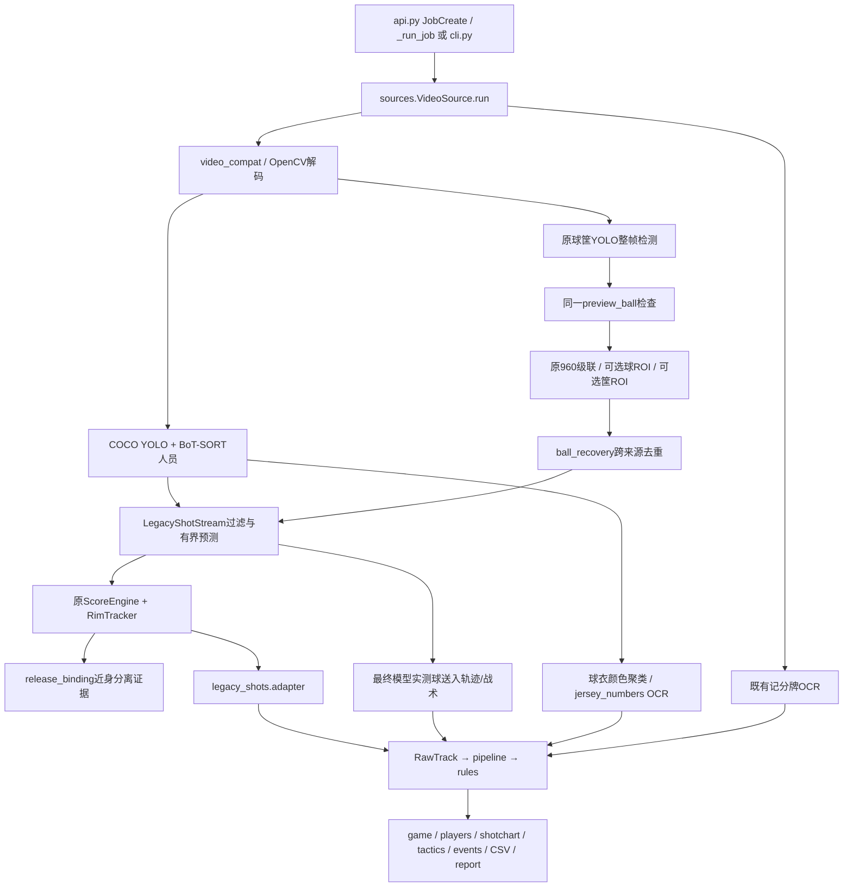

# 篮球视频分析诊断与优化完整交付

**统计区间：北京时间2026-10-15（周四）21:57至2026-10-16 19:35。**

项目根目录：`/data/projects/ai-basketball-analyst`。本文件把该时段的诊断、实现、配置、测试、标注和复现入口集中起来；历史单轮报告及原始日志保留。首次基线inventory生成于10月15日22:01:43，时间在本次区间内。

## 1. 当前可以确认的结论

1. Ubuntu上的CUDA检测、追踪、事件转换、统计与JSON输出链路能够执行；本次真实失败任务已修复并跑完。**任务完成不代表篮球、篮筐、出手和命中全部识别正确。**
2. 实际默认球/筐模型是E-BARD的**YOLOv8n四分类**，不是假定的YOLOv8s两分类。球员仍为COCO yolov8n，BoT-SORT实际默认没有ReID。
3. 修复了运动块冒充实测、粗hoop框几何适配、小球硬过滤、跨队/切镜ID补接、时长元数据、ROI判断与候选口径、平移误切镜、出手时间/归属证据及未经确认的分值。
4. NBA的30秒隔离短片在最新默认配置仍输出0事件；训练短片默认保留1次UNKNOWN，实验配置保留1次MADE。**NBA漏检尚未解决，没有整体准确率提升结论。**
5. 11张完整审核开发帧上，原始检测器conf=.25为P=42.86%、R=37.50%、F1=40%；降至.15没有增加TP，反而增加FP。低分确认和高频ROI仍不是默认启用策略。
6. 线上已于10月16日15:29切至固定代码快照；此前报告中“未部署”是当时状态。暂停中的记分牌融合显式禁用。没有训练新模型或更换线上默认权重。
7. 最新已保存全量Python结果为598 passed、2个既有失败、15 skipped、9 subtests passed；交付时复核工具/契约/事件等45项通过。没有宣称全量门禁通过。

## 2. 时间线与证据入口

| 阶段 | 做了什么 | 主要证据 |
| --- | --- | --- |
| 10月15日21:57后：步骤1、2 | 审查真实模型/入口/ROI/状态机，核对素材和真值，采集GPU基线；此阶段未改业务算法 | [诊断与基线](CV_BASELINE_2026-10-15.md)、[原始inventory](../../out/cv_baseline_20261015/inventory.json) |
| 10月16日上午：步骤3 | 小球下限、运动块证据隔离、hoop细化、安全ID补接、时长修复；GPU回归和候选消融 | [步骤3报告](CV_STEP3_2026-10-16.md)、[对比](../../out/cv_step3_20261016/step3_comparison.json) |
| 10月16日中午：步骤4 | 候选去重/来源、同一人头过滤上下文、平移复核、低分时序确认、两ROI四组实验 | [步骤4报告](CV_STEP4_2026-10-16.md)、[汇总](../../out/cv_step4_20261016/summary.json) |
| 10月16日下午：步骤5 | 当前真实球坐标、保守近身—分离绑定、候选时间与离手估计分开、未知队别/分值统计、JSON证据贯通 | [步骤5报告](CV_STEP5_2026-10-16.md)、[汇总](../../out/cv_step5_20261016/summary.json) |
| 15:29～15:38：运行故障修复 | 老进程混用新适配器导致release_known参数错误；固定快照、契约预检、原任务复跑 | [故障修复](CV_RUNTIME_FIX_2026-10-16.md)、[完成证据](../../out/runtime_fix_20261016/completion.json) |
| 19:35：交付复核 | 核对快照SHA、运行进程、任务完成状态、工具/契约测试、配置与交付文件 | 交付目录中的live_checks.json、delivery_tests.log、SHA256SUMS |

这些改动存在于本机工作区与代码快照中；区间内没有新增Git提交或push。HEAD仍为`56b9317d8cc561199786811069d54c40d2e47da5`，工作区本来已有大量未提交工作。不能把全部git diff归为本次改动，更不能用HEAD单独复现本次算法版本。

## 3. 完整仓库诊断

### 3.1 运行环境与模型

| 项目 | 核实结果 |
| --- | --- |
| 项目环境 | `/data/conda-envs/ai-basketball-analyst/bin/python`；Python3.11.15 |
| GPU | NVIDIA Quadro RTX5000，16GiB；基线驱动595.84 |
| 推理框架 | PyTorch2.11.0+cu128、CUDA12.8、Ultralytics8.4.175、OpenCV5.0.0 |
| 球员模型 | models/yolov8n.pt，COCO80类；最终接收person，track调用未用classes=[0]限制全部推理类别 |
| 球/筐默认 | models/BODD_yolov8n_0001.pt；0 basketball、1 hoop、2 player、3 referee；checkpoint训练imgsz704 |
| 备用模型 | shottracker_best.pt、shottracker_before_best.pt；0 basketball、1 rim；均YOLOv8n、训练imgsz640；未替换默认 |
| 缺失路径 | runs/detect/ball/weights/best.pt、runs/detect/rim/weights/best.pt不存在 |
| BoT-SORT | installed botsort.yaml with_reid=false；buffer30、new_track_thresh=.25；自带ReID配置未默认使用 |
| 抽帧 | 球与投篮主循环逐帧；人员stride2约15Hz；名义时间idx/fps，VFR PTS尚未全面核验 |
| GPU使用 | YOLO使用device0；单任务复用模型实例；解码/几何/后处理并非全部在GPU；未验证FP16收益、未做任务间模型池或统一GPU计时 |
| OCR | Linux本地EasyOCR和模板路径已存在，离线模型可用；OCR读取率不是正确率，完整得分回溯尚未实现 |

模型SHA、训练元数据、实际tracker配置、包版本完整保存在交付的configs和evidence内。原始资源来源见[ASSETS.md](../../deploy/ASSETS.md)。视频、模型、账号库与纠错原图保留在本机资源目录；交付包用路径和SHA定位它们。

### 3.2 实际调用关系



| 模块 | 路径与当前边界 |
| --- | --- |
| 服务入口 | `src/aihoop/api.py`；任务数据库data/jobs.sqlite，产物out/job_id |
| 原始结果与视频执行 | `src/aihoop/sources.py`：VideoSource、Attempt、RawTrack；本项目网页是web/，不是IDE中的羽毛球Flutter页面 |
| 选球与预测 | `legacy_shots/stream.py`、`ball_selection.py`：尺寸/头部/UI/时序门控，多候选评分，有界线性速度预测；不是篮球Kalman实现 |
| ROI | `ball_recovery.py`：复用同一模型、原坐标加一次offset、记录region/source、合并去重；不新增第二套ROI |
| 篮筐 | 联合模型框→pick_rim→scorer.RimTracker；hoop.py细化粗hoop区域，hoop_lock.py处理人工框；legacy不另建hoop专用YOLO，geometry备用路径仍有额外推理成本 |
| 投篮结果 | `legacy_shots/scorer.py`：attempt/entered/crossing/needs_leave等原状态，真实穿筐连续证据；缺证据保留UNKNOWN |
| 归属 | `legacy_shots/release_binding.py`：至少两次唯一近身和两次分离；重叠/遮挡/间隔不合格保持未知；仅上半身代理，不是手部真值 |
| 球员角色 | 已有可信标定脚点、形状/置信度/人数约束；尚无PLAYER/REFEREE/SPECTATOR/UNKNOWN四态分类器，场内裁判和漏检仍未彻底解决 |
| 球队/号码 | sources._assign_teams已有上身HSV多帧聚类；jersey_numbers.py已有质量采样与多帧OCR；缺少颜色输入的人员仍有默认home风险，真实主客队映射与跨镜头身份仍不完整 |
| 输出 | model.py、rules.py、pipeline.py；新证据贯通Attempt→Shot→时间线；未知地面位置不生成假热区 |
| 记分牌 | read_marked_scoreboard.py、logo_scoreboard.py、scoreboard.py；暂停中的scoreboard_fusion在服务禁用；没有完整ScoreGuidedShotRecovery |
| 调试 | raw逐帧候选、拒绝原因、预测/测量标志、ROI、篮筐状态、shot_state/shot_evidence；统一完整Debug视频导出尚未完成 |

### 3.3 缺陷、修复与残留风险

| 发现 | 本区间修复 | 仍需验证 |
| --- | --- | --- |
| hoop大框常包含篮网，被篮圈高宽比拒绝 | 复用hoop真实红橙横向像素候选细化，唯一合格才接纳；原生rim和人工框走原路径 | 遮挡、黑篮圈、变焦和移动镜头的更新稳定性 |
| HD最小球边11.52px硬拒绝远景小球 | 默认4px下限，可恢复旧比例做对照 | 仅放行候选不代表模型召回已提高 |
| motion_ball曾被算作真实观测 | is_measurement排除运动块和预测，ScoreEngine独立保护 | 运动恢复仍只作诊断，不能证明篮球身份 |
| ID补接跨球队/切镜 | 默认关闭；显式启用要求已知同队、不过切镜、唯一匹配并重映射引用 | 真实跨镜头身份尚不存在 |
| 头部假球让ROI不触发 | 前后共用全部可用person头部上下文 | personnel漏检与隔帧旧框可能误挡真球 |
| 多尺度/裁剪重复球与两条轨迹口径 | 来源记录、同帧IoU去重、不抬高置信度；战术优先用最终实测选择 | 飞行球投影不能直接视为地面位置，战术有效性另验 |
| 镜头平移误报切镜 | 对原切镜报警用分布ORB/RANSAC复核，防止角标单独证明连续 | 无可靠回放分类；Lillard内部筐可用帧出现下降 |
| 中位数拼接不同帧坐标 | 默认当前真实观测，保留旧模式对照 | 对单帧错误候选更敏感，须连同负例回归 |
| 持球长者/脚边球被绑定为出手人 | 保守近身—分离、时间与坐标同源、候选超时独立 | release仍是估计；未知归属可能增多，不能宣称归属率提高 |
| 无标定2分标成已确认、未知队别装进主队 | 估算不确认计分、team=unknown、未知队名中性显示 | 旧历史任务不自动重算；不同统计口径须逐项复核 |
| 文件头1044帧、实际902帧 | 保存reported/decoded，duration按实际解码计数 | VFR、音视频PTS映射未全面解决 |
| 老服务动态导入新文件 | 固定代码副本、启动契约检查、原任务复跑 | 更新必须整体切换副本，不能原地修改生产代码 |

## 4. 完整配置交付

交付包`configs/legacy_detect_default.json`为当前公开配置完整值，`effective_stream_config.json`包括检测和原状态机最终阈值；`legacy_detect_schema.json`给出类型/范围。阶段报告解释各参数的风险与回退。

| 配置组 | 默认值/行为 |
| --- | --- |
| 球检测 | standard imgsz640；ball_conf=.25、ball_candidate_conf=.25；NMS IoU=.5；最小边4px |
| 低分确认 | ball_low_conf_confirm=false；最少3帧、窗口.25s、至少2px位移、历史最多16候选；不能跨切镜确认 |
| ROI | ball_roi_recovery=false、ball_rim_recovery=false；缺球重试5Hz；每帧最多2次裁剪；球crop640、筐crop960。**有效人工篮筐尺寸可使VideoSource自动开启筐ROI** |
| 球ROI范围 | 近期真球≤.5s；速度外推最多5帧；半径96～384px，随球尺寸/缺失间隔调整 |
| 筐ROI范围 | 必须新鲜篮筐；半径至少96px，通常5×筐宽；过期不触发 |
| 切镜复核 | scene_motion_guard=true；20匹配、内点率.45、3×2网格至少3格各≥3内点、图像最大边640 |
| 篮筐细化 | rim_refinement=true；真实像素唯一合格才采用；完整9项阈值在JSON中 |
| 轨迹口径 | ball_track_selected_only=true，专用模型存在时生效；缺模型保留原COCO后备 |
| 人员ID补接 | player_track_stitch=false，启用也不能跨队/跨镜头强接 |
| 事件几何 | shot_evidence.ball_geometry_mode=measured；median3用于显式旧模式对照 |
| 出手归属 | release_binding_mode=contact_sequence；近身2帧、分离2帧、各最大间隔.25s、回看2s；坐标/时间来源一起输出 |
| 结果门限 | 保留原make_window=.9s、ball_recent=.5s、miss_timeout=3.5s、rim_stale=1.5s、need_confirm=2；未因想增加出手数而放宽 |
| 部署开关 | AIHOOP_DISABLE_SCOREBOARD_FUSION=1；固定PYTHONPATH快照。实际生效值另取请求标定、人工筐框和运行trace，不把配置默认值冒称每个任务的有效值 |

实验配置单列：`dense_only.json`仅把缺球重试改15Hz；`dense_low_candidates.json`同时改候选.15、多帧确认true、重试15Hz，两个ROI由实验命令modes=both开启。**未把它们设为线上全局默认。**

回退：用显式开关对照旧绑定/median3、关闭scene_motion_guard/ROI/细化等；不要把未确认分值重新标成已确认。代码回退只选完整版本或本轮差分，不对包含其他工作的仓库reset。

## 5. 实测结果与测试结果

### 5.1 人工审核帧：原始球检测器

11完整帧、3个开发来源、8真球框、3无球负例。图片/记录SHA与旧基线一致，IoU≥.5、一对一匹配。

| E-BARD原始conf | TP | FP | FN | Precision | Recall | F1 | 负例有误检帧 |
| --- | ---: | ---: | ---: | ---: | ---: | ---: | ---: |
| .25 | 3 | 4 | 5 | 42.86% | 37.50% | 40.00% | 0/3 |
| .15 | 3 | 11 | 5 | 21.43% | 37.50% | 27.27% | 1/3 |

这是原始检测器开发子集，不是最终时序/ROI系统指标，不是独立测试。FP是未匹配框，未专项核对前不能把所有FP称为人头或Logo。

### 5.2 GPU视频与消融

| 测试 | 真实模型球观测帧 | 内部筐可用帧 | 输出 | 时间 |
| --- | ---: | ---: | --- | ---: |
| 初始Lillard30s，有OCR | 93；另71运动块曾误算实测 | 0/902 | 0事件 | 54.99s，16.40FPS |
| 步骤3 Lillard，有OCR | 123 | 191/902 | 0事件 | 56.92s |
| 步骤4 Lillard，两ROI，默认阈值 | 130 | 161/902 | 0事件 | 30.14s，无OCR |
| 步骤4 Dairy，两ROI，默认阈值 | 227 | 835/836 | 0事件 | 36.75s，无OCR |
| 步骤4 Dairy，15Hz+.15实验 | 289 | 835/836 | made1 | 44.36s |
| 步骤4 Lillard，15Hz+.15实验 | 151 | 161/902 | 0事件 | 33.87s |
| 步骤4 ShotTracker备用，Dairy | 324 | 835/836 | made2、unknown1 | 37.83s |
| 步骤4 ShotTracker备用，Lillard | 57 | 371/902 | unknown2、made0 | 31.75s |
| 步骤5默认，Dairy，ROI关闭 | 223 | 835/836 | unknown1 | 36.42s |
| 步骤5默认，Lillard，ROI关闭 | 129 | 161/902 | 0事件 | 30.02s |
| 步骤5 Dairy，15Hz+.15实验 | 289 | 835/836 | made1、归属未知 | 42.71s |

步骤4做了22次完整视频运行，包括修改前后各8组ROI、2组仅15Hz、2组15Hz低分确认、2组备用权重；步骤5做了3次GPU运行。步骤5还对6份缓存检测做4种事件配置，共24组；初始/最终重复回放不算新增独立样本。

这些观测数不是Recall、筐可用率不是筐准确率。ShotTracker和Dairy同来源不能当独立泛化，NBA上球观测反而较少，不支持切默认权重。Lillard误切镜报告从13降为1，但筐可用帧191降为161，不能只报收益。

基线OCR耗时约24.8秒，检测阶段约23.2秒；无OCR实验不能直接与有OCR基线计算加速倍数。上述均单次、部分并发CPU测试、未严格控制冷/热启动，不代表全部视频服务器吞吐。

### 5.3 自动测试

| 版本 | 相关测试 | 全量Python | 说明 |
| --- | --- | --- | --- |
| 原基线 | 采集器3通过 | 556通过、3失败、15跳过、9 subtests | 第3失败是缺系统node |
| 步骤3 | 103通过 | 573通过、3失败、15跳过、9 subtests | 同基线失败 |
| 步骤4最终 | 72通过 | 584通过、2失败、15跳过、9 subtests | 临时Electron Node包装通过环境项 |
| 步骤5 | 90通过 | 598通过、2失败、15跳过、9 subtests | 全量后的小型队名补丁已目标复验 |
| 运行混版修复 | 42通过 | 未再次跑全量 | 旧模型契约拒绝、暂停融合开关、适配回归 |
| 本次交付复核 | 45通过，1.55s | 未重复全量 | 加采集器分母测试，不重新做GPU分析 |

剩余2个既有失败：`test_multical_mini_and_snap::test_soft_failure_exit_carries_both_keys`的少点提示文案；`test_plan_b::test_tactics_end_to_end_and_frames`的合成15s空人员断言。未删除断言掩盖失败。

verify_doc_refs历史运行通过，但只覆盖docs根目录手册；不等于所有CLI、文档代码和浏览器全操作验收通过。交付报告的本地Markdown链接另行校验。

### 5.4 线上故障与当前状态

旧进程PID220604自10月15日21:48运行，在工作区改动后延迟导入新adapter，旧Attempt不接受release_known，真实任务约50%失败。原因是运行/开发代码未隔离，而非用户标定或视频上传错误。

10月16日15:29:54切到`deploy/runtime/20261016-152930`固定副本，服务PID262365；启动先跑check_runtime_contract；暂停记分牌融合禁用。原任务`c299e023441c`于15:38:07完成，progress1、error=null，game/players/shotchart/tactics/report等已生成并校验。

程序输出10条投篮记录、确认比分2:0，这是该视频、标定与人工筐框下的算法输出，**未逐球验收，不能称10条全对或2:0判准**。“事件0条”旧summary指另一类通用事件，与时间线10条投篮不是同一字段。该完整177秒任务不能与未标定30秒剪辑直接比较。

19:35复查固定副本171个文件SHA全部匹配，服务active，原任务仍done。当前开发目录继续改动不会被线上延迟导入。视频/账号/数据库仍在原项目，不复制进代码快照。

## 6. 标注规范与待补样本

完整规范见[CV_ANNOTATION_PROTOCOL.md](CV_ANNOTATION_PROTOCOL.md)；交付包额外包含`annotation_queue.csv`，标注任务全部标为待人工完成，不能当真值导入。

### 6.1 必须遵守

- **按原始比赛source_match_id分train/validation/independent_test**。剪辑、转码、相邻帧和重复回放继承同比赛ID，不随机混分相邻帧。参与过调参的来源永远不再冒称独立测试。
- 视频/图片SHA、原始帧号/PTS、原片时间、尺寸、标注人、审核状态一起保存。裁剪后相对秒不直接当原片秒；映射需父视频哈希和偏移。
- 坐标为原始画面归一化xyxy。球可见、不可见、看不清、遮挡分别记录；不可见帧不编框，看不清不当负例。
- 球标完整可见用球；rim标篮圈开口，不能拿篮网大框冒充篮圈；person角色/脚点可见性/球队/号码/真实身份分别允许UNKNOWN。
- **局部纠错不是整帧完整标注**。只有审核通过、frame_complete=true、training_approved=true、有来源ID/哈希的记录才进现有训练入口。球和人员的完整性应分别审核。
- 出手标event_id/play_id、release区间、rim时刻、made/missed/unknown、分值/身份未知项、回放对应关系。补篮另一个event_id；空出手列表只有shots_complete=true才可作为零出手真值。
- 记分牌记录屏幕顺序与真实球队映射、old/new、更新延迟、OCR不可读、回放/广告/特写；+1/+2/+3不自动等于一个投篮事件。

### 6.2 当前缺口

| 材料 | 已有 | 需要补齐 |
| --- | --- | --- |
| 审核纠错帧 | 11完整帧、8球框、3负例 | 真球与头/Logo同时出现的完整帧；运动模糊、远景、持球、遮挡；不能只补负例 |
| Windows四段旧标注 | 32帧、4次出手的记录存在 | 4个原视频、32张原图及SHA映射；原视频/图片缺失，不用相似文件替代 |
| 用户杨瀚森/利拉德/哈登记录 | ordinal/近似时刻 | 原视频SHA、精确或明确区间的离手/过筐、回放/真实出手人 |
| Dairy开发窗口 | 自动trace、联系图 | 5～7.5s、14～16s、24～27.5s逐帧真球/筐及实际离手；这些是待核对窗口，不是已标注事件时间 |
| Lillard30s | 902帧trace | 全段镜头/回放/罚球、真球、人头、篮圈开口；连续误切镜候选前后都看 |
| 人员角色与ID | 自动person和临时ID | 远景/罚球/裁判/替补席/特写/遮挡连续窗口；静止球员不能因不动被排除 |
| 连续球轨迹 | 自动轨迹 | 原始帧率真球位置、遮挡及切镜，不把预测当真值 |
| 独立测试 | 尚无锁定的未开发新来源 | 未用于训练/调参的NBA/CBA比赛，先登记来源再标注/评估 |

18场景：远景球、快速传球、三分、上篮、扣篮、补篮、未中、球遮挡、看台、Logo、裁判、球员遮挡、切镜、慢动作回放、OCR错读、比分延迟、罚球、连续投篮。每类建议至少3个完整窗口作为采集起点，**不是足够证明总体精度的样本量**。

现有serve_match_labeling只支持ball/decoy和基础投篮字段；rim/person角色、PTS和复杂身份扩展需要先让工具明确支持，或用兼容旁表，不能往现有校验器塞不支持的kind。旧check_truth_files要求其对应测试集sample ID/时间区间，不能拿新来源随意套旧索引。

### 6.3 指标分母

只有完整帧计算球P/R/F1，IoU≥.5一对一，空分母null；人员召回需要完整person真值，误纳率单列角色UNKNOWN；轨迹中断需要人工真实球ID与固定间隔；事件用一对一时间匹配，±1.5s预先固定，近似时刻单列；出手人准确率同时报告未归属率；OCR读取率不能替代正确率。

目前最终球框系统P/R、人员Recall、角色误纳率、真实轨迹中断、出手/命中P/R、归属准确率、OCR正确率与回溯补回率均**尚不可严格计算**。

## 7. 可复现采集工具与运行命令

### 7.1 工具清单

| 工具 | 作用/边界 |
| --- | --- |
| [collect_cv_baseline.py](../../scripts/collect_cv_baseline.py) | 冻结dirty源码、manifest、Git身份、模型SHA/类别/包版本/tracker；可选审核帧评估与VideoSource→Pipeline真实smoke；拒绝覆盖已有输出目录 |
| [eval_ball_feedback.py](../../scripts/eval_ball_feedback.py) | 只消费已审核完整帧，原始检测器一对一匹配，输出TP/FP/FN；不是时序系统评估 |
| [replay_cv_baseline.py](../../scripts/replay_cv_baseline.py) | 固定NMS候选回放，不增加检测/ROI；不能当完整GPU消融 |
| [benchmark_ball_recovery.py](../../scripts/benchmark_ball_recovery.py) | none/ball/rim/both完整推理对照；支持显式旧权重和实验JSON，不改线上默认 |
| [benchmark_shot_evidence.py](../../scripts/benchmark_shot_evidence.py) | 同一已选检测的旧绑定/新绑定、median3/measured四组；不回查新视频证据 |
| [check_runtime_contract.py](../../scripts/check_runtime_contract.py) | 启动前验证Attempt/Shot字段、同一代码根和证据贯通 |

工具参数帮助可用`--help`检查。以下命令在原项目根运行；使用新目录名，已存在时采集器会拒绝覆盖。工具运行的是**当前源码版本**；原始10月15日指标须使用当时快照，不是今天重跑当前工具就会得到原来数字。

### 7.2 当前版本基线采集

```bash
cd /data/projects/ai-basketball-analyst
PYTHONPATH=src /data/conda-envs/ai-basketball-analyst/bin/python \
  scripts/collect_cv_baseline.py \
  --out out/cv_reproduce_baseline_01 --device 0 \
  --run-feedback --smoke-video data/samples/validation_lillard_30s.mp4

# 无OCR变体：新目录，不能拿耗时直接对比有OCR变体
PYTHONPATH=src /data/conda-envs/ai-basketball-analyst/bin/python \
  scripts/collect_cv_baseline.py --out out/cv_reproduce_no_ocr_01 \
  --smoke-video data/samples/validation_lillard_30s.mp4 --no-scoreboard --device 0
```

采集产物：inventory.json、source_manifest.json、source_snapshot.tar.gz、worktree.patch、git_status.txt；审核帧启用时有feedback_snapshot/manifest、feedback_detector/metrics/log；视频启用时有smoke_config、video_probe、raw_track、analysis和smoke_metrics。worktree.patch可能含此前其他未提交工作，只在本机保留，交付包不拿它冒称本次专属差分。

### 7.3 原始检测器与ROI对照

```bash
PYTHONPATH=src /data/conda-envs/ai-basketball-analyst/bin/python \
  scripts/eval_ball_feedback.py --feedback-dir data/ball_feedback \
  --weights models/BODD_yolov8n_0001.pt --imgsz 640 --conf .25 \
  --device 0 --out out/cv_reproduce_feedback_01.json

PYTHONPATH=src /data/conda-envs/ai-basketball-analyst/bin/python \
  scripts/benchmark_ball_recovery.py \
  --videos data/samples/shottracker/DairyCourts.MOV data/samples/validation_lillard_30s.mp4 \
  --out out/cv_reproduce_roi_01 --device 0

# configs路径填交付目录内的文件；仅为实验
PYTHONPATH=src /data/conda-envs/ai-basketball-analyst/bin/python \
  scripts/benchmark_ball_recovery.py --videos data/samples/shottracker/DairyCourts.MOV \
  --modes both --detect-options out/cv_step4_options/dense_low_candidates.json \
  --out out/cv_reproduce_dense_01 --device 0
```

### 7.4 缓存回放

```bash
PYTHONPATH=src /data/conda-envs/ai-basketball-analyst/bin/python \
  scripts/replay_cv_baseline.py \
  --raw out/cv_baseline_20261015/raw_track.json \
  --out out/cv_reproduce_cached_candidates_01

PYTHONPATH=src /data/conda-envs/ai-basketball-analyst/bin/python \
  scripts/benchmark_shot_evidence.py \
  --raws out/cv_step4_dense_low_20261016/00_DairyCourts_both/raw_track.json \
  --out out/cv_reproduce_event_logic_01
```

要复现某阶段而不是当前实现，交付保留了原source_snapshot与manifest、模型SHA、原始raw路径/哈希和配置。先在另一个空目录恢复对应快照，核对manifest，再提供相同视频/模型/审核帧和环境。不要解压覆盖开发目录或运行副本。阈值相同但源码不同也不叫同基线；GPU非确定性和库版本差异也需记录。

### 7.5 测试、标注和在线只读检查

```bash
PYTHONPATH=src /data/conda-envs/ai-basketball-analyst/bin/python -m pytest -q \
  tests/test_collect_cv_baseline.py tests/test_runtime_contract.py \
  tests/test_shot_evidence_stage5.py tests/test_shot_legacy_engine.py tests/test_scoreboard_fusion.py

# 本机没有系统node时，用已有包装覆盖PATH，不安装新依赖
PYTHONPATH=src PATH=/data/projects/ai-basketball-analyst/out/cv_baseline_20261015/tools:$PATH \
  /data/conda-envs/ai-basketball-analyst/bin/python -m pytest -q

PYTHONPATH=src /data/conda-envs/ai-basketball-analyst/bin/python scripts/verify_doc_refs.py
PYTHONPATH=src /data/conda-envs/ai-basketball-analyst/bin/python scripts/check_runtime_contract.py

# batch必须先含已登记来源、有效manifest和待标图片，不是任意视频目录
/data/conda-envs/ai-basketball-analyst/bin/python scripts/serve_match_labeling.py \
  --batch /data/你的标注批次目录 --port 8127
# 打开 http://127.0.0.1:8127，仅本机监听

/data/conda-envs/ai-basketball-analyst/bin/python scripts/check_truth_files.py
systemctl --user show ai-basketball-analyst.service \
  --property=MainPID,ActiveState,ActiveEnterTimestamp
```

标注校验通过只能证明格式合格，不能证明语义正确；应另行审核。check_truth_files中的建议数量不是足够泛化的统计保证。本次没有启动训练。

## 8. 源码身份与交付包说明

原基线源码压缩包SHA256：`a56de57f09f690cba4fba0b103cda15e8bbd94566ef091d4331afc3baac2e627`。

本次交付目录包含：

- README与本总报告、6份原审计/标注文档；
- configs：公开默认、JSON Schema、实际流配置、实验配置、运行服务覆盖、环境版本及资源SHA；
- tools：基线采集、评估、两类消融、原候选回放、运行契约检查；
- tests：相关新增保护测试与交付复验日志；
- evidence：各阶段原指标/对比、测试日志、4份阶段源码快照、当前运行副本身份与故障完成证据；
- annotation_queue.csv、source_groups.json：待人工完成的样本清单和来源分组约束；
- manifest.json和SHA256SUMS：本次交付文件的完整性。

交付是本机文件包，不是GitHub提交，也不自动公开到网站。大视频、权重、用户数据库、凭据、全部107MB等逐帧raw仍在原目录，包内给出身份/路径及复现要求。原始快照包含冻结时工作区内容，可能含暂停代码；运行副本以禁用开关保持暂停功能不生效，不能把“源码存在”说成“功能已上线验收”。

## 9. 尚未完成与下一步

1. 首先补独立比赛来源、完整逐帧球/筐/角色及事件真值，再评估远景、模糊、遮挡、观众/Logo共存。
2. 继续补真实球观测和移动镜头下篮筐更新，修复NBA片段0出手的检测阻断；不靠放宽投篮条件或无限预测。
3. 四态人员角色、可靠球队UNKNOWN/真实主客队映射、两队人数和跨镜头身份仍待完善。
4. 记分牌变化→候选关联→3～12秒高密度回溯→融合去重尚未完整实现；无画面/球员证据只保留得分事实，不伪造投篮。
5. 统一Debug视频、18场景人工验收、完整模块消融和旧素材回归仍待完成。
6. 现有证据先支持实现修复与标注补齐，不支持立即重新训练。若来源隔离评估证明模型能力不足，再用审核完整帧做小目标/模糊/遮挡及头部/Logo困难负例训练，并对旧素材回归后决定启用。
